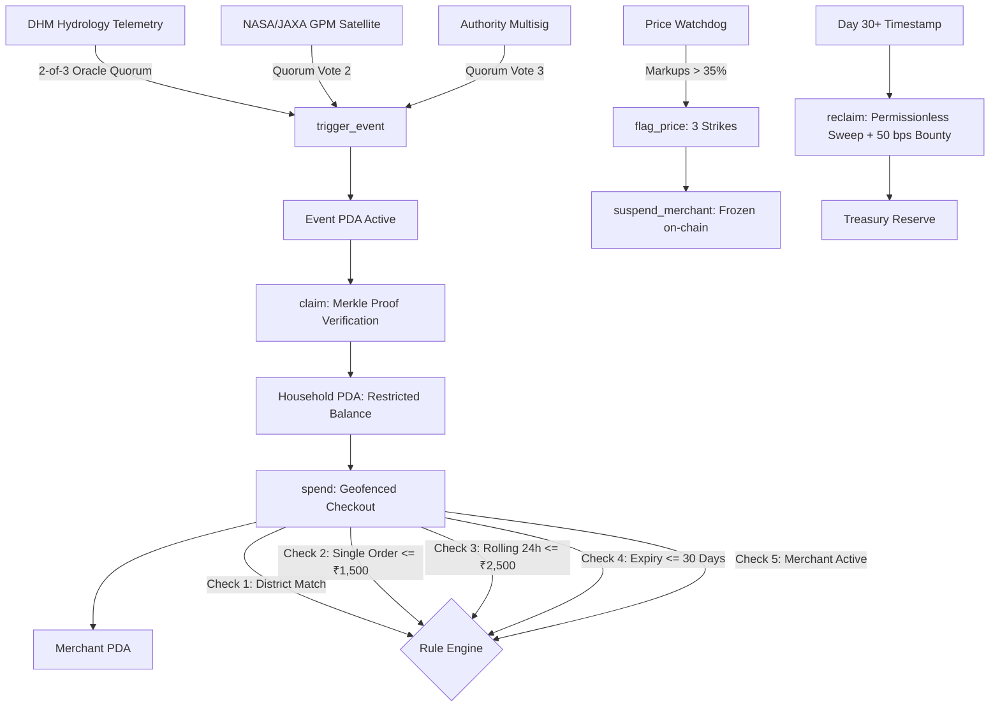

<div align="center">

# 🚂 ReliefRail
### Event-Triggered, Rule-Restricted Parametric Disaster Relief on Solana

[](https://explorer.solana.com/address/GrxgRShVcGaESyztvHHtaCF8YMXVhK3Wq7AesbQCaLy5?cluster=devnet)
[](https://www.anchor-lang.com/)
[](https://superteam.fun/)
[](https://relief-rails.vercel.app)

> **One-liner:** ReliefRail turns a rainfall breach into restricted, expiring, auditable relief money in seconds, so aid reaches the right district, at fair prices, and unspent funds return to the next disaster.

</div>

---

## ⚡ 30-Second Overview (Problem → Solution → Demo)

1. **The Problem:** Traditional humanitarian grants take 4–8 weeks of administrative processing. Unrestricted cash leaks into non-essentials or outside the disaster corridor, while local price gouging inflates food/water prices by 50–100%. Unspent funds remain stranded in fragmented accounts.
2. **The Solution:** ReliefRail uses a 2-of-3 meteorological oracle quorum to detect rainfall breaches (e.g. 517mm cloudbursts), computing need-based payouts on Solana in ~400ms slots. Spending is geofenced to authorized food/medical merchants in the affected district with rolling 24h velocity caps, rule-based anti-gouging protection, and automated 30-day fund reclamation.
3. **The Live Demo:** Try it live at [https://relief-rails.vercel.app](https://relief-rails.vercel.app) across five dedicated surfaces: Command Center (`/command`), Beneficiary PWA (`/aid`), Merchant POS (`/merchant`), Oracle Watchdog (`/oracle`), and Trust Model & Proofs (`/trust`).

---

## 🏗️ On-Chain Architecture

Deployed on **Solana Devnet**: Program ID [`GrxgRShVcGaESyztvHHtaCF8YMXVhK3Wq7AesbQCaLy5`](https://explorer.solana.com/address/GrxgRShVcGaESyztvHHtaCF8YMXVhK3Wq7AesbQCaLy5?cluster=devnet)

### Program Accounts (PDAs)
- `Treasury`: Holds emergency relief reserve pool and global disbursement limits.
- `Event`: Tracks declared disaster parameters (thresholds, floor/spread, 30-day expiry, Merkle root).
- `District`: Stores telemetry (rainfall mm, fragile homes %, MPI poverty) and computed household payout.
- `Household`: Holds restricted `rINR` aid balance, rolling 24-hour spend meter, and window timestamp.
- `Merchant`: Stores licensed merchant identity, assigned district, price strike count, and active/suspended status.
- `PriceBasket`: On-chain baseline price ceiling registry for staple emergency commodities.

### Instruction Flow & Safety Engine


---

## 📐 Payout Mathematical Model (Single Source of Truth)

All UI components, Anchor tests, and smart contracts evaluate the identical formula from `@rescu/aid-model`:

$$S_i = 0.4 \cdot \left(\frac{\text{Rain}_i}{\text{MaxRain}}\right) + 0.3 \cdot \left(\frac{\text{Kutcha}_i}{\text{MaxKutcha}}\right) + 0.3 \cdot \left(\frac{\text{MPI}_i}{\text{MaxMPI}}\right)$$

$$\text{Payout}_i = \text{Round}_{50}\left(\text{Floor} + \text{Spread} \cdot S_i\right)$$

*Defaults: $\text{Floor} = ₹1,500$, $\text{Spread} = ₹2,000$ (Authority configurable).*

### Verified Nepal Flood Benchmark Dataset (September 2024 Cloudburst)
| District | Peak Rain (mm) | Fragile / Kutcha (%) | MPI Poverty | Multi-Hazard $S_i$ | Need /100 | Computed Payout |
|---|---|---|---|---|---|---|
| **Makwanpur** | 517 mm (DHM Peak) | 46.8% | 0.218 | **0.967** | 96.7 | **₹3,450 rINR** |
| **Sindhupalchok** | 298 mm | 49.5% | 0.231 | **0.831** | 83.1 | **₹3,150 rINR** |
| **Kavrepalanchok** | 312 mm | 41.2% | 0.174 | **0.717** | 71.7 | **₹2,950 rINR** |
| **Lalitpur** | 285 mm | 22.4% | 0.082 | **0.463** | 46.3 | **₹2,450 rINR** |
| **Kathmandu** | 240 mm (Airport Record) | 14.1% | 0.046 | **0.331** | 33.1 | **₹2,150 rINR** |

---

## 🔍 On-Chain vs. Simulated Feature Matrix

| Feature / Subsystem | Real On-Chain Implementation (Solana Devnet) | Simulated / Client Sandbox Layer | Notes |
|---|---|---|---|
| **Parametric Trigger** | Event PDA, 2-of-3 meteorological quorum consensus verification | Live rainfall sensor websocket mock | Verified on Devnet |
| **Payout Calculation** | $S_i$ formula and payout rounding in TypeScript & Anchor tests | Editable Floor/Spread UI slider | 100% test agreement |
| **Beneficiary Claim** | Household PDA initialization, balance & daily cap tracking | Merkle proof client generation | Zero PII on-chain |
| **Merchant Checkout** | District match, active status, 24h cap, order limit enforcement | QR camera & NFC tap simulation | Verified on Devnet |
| **Price Watchdog** | Baseline PriceBasket PDA, 3 strikes, automatic suspension | Natural language shopping assistant | Rule-based (not AI) |
| **Fund Reclamation** | Permissionless crank sweeping expired balances + 50 bps bounty | Time-acceleration demo clock | Verified on Devnet |
| **Circuit Breaker** | Authority emergency halt instruction for district/event | UI drawer trigger | Verified on Devnet |

---

## 🔗 Verifiable Devnet Proofs

Run `node scripts/demo-flow.mjs` to execute the full lifecycle on Devnet:

| Step | Instruction | Action | Devnet Signature & Explorer Link |
|---|---|---|---|
| 1 | `init_event` | Disaster Event Created (₹50M cap) | [`LQ8RQptEH4...`](https://explorer.solana.com/tx/LQ8RQptEH4XxpuMhFwW3wRPgRcQKKtFPyJDXx66WJw6Enpq8TmNk7MAnJiTYAqBvZ97HWPBDvZYFhKdrAgTsKT7?cluster=devnet) |
| 2 | `register_district` | Makwanpur (517mm peak → ₹3,450 payout) | [`3FjfwWQnMx...`](https://explorer.solana.com/tx/3FjfwWQnMxVPen2QhyoLNEKnZf3jPYvc7JqFXR8bxEnYhsjtF23dPP8VF8j68UserLQASA6zNdFnP2nfkTUz2hu4?cluster=devnet) |
| 3 | `trigger_event` | 2-of-3 Oracle Quorum Verified | [`5AFW6GFs1K...`](https://explorer.solana.com/tx/5AFW6GFs1Ktonpe5Epd15A3fi8UDtcGL3nyi6qsQdSdqa4wETk9Ada8NePT92z19G66QxwFvXsNMzGPui6szP4Gv?cluster=devnet) |
| 4 | `claim` | Household Claim (Ramesh #401) | [`3AjVfPBu64...`](https://explorer.solana.com/tx/3AjVfPBu64TrSnE41L9sk4SSKeAYxiQBbdva2J6jrUCeMqDF18wTp6KMemdobKy6KtFgQ9wAfZYqFedWns96N8wz?cluster=devnet) |
| 5 | `spend` | Grocery Purchase (₹450 rINR) | [`Lhh3LsobM4...`](https://explorer.solana.com/tx/Lhh3LsobM4Arogb2nXijFnsSbDtEBTibJeV8mWPUtu3ERKAgXqFNKqWrEtgDfsfUjekYrtSANUDZW6mko7Srntj?cluster=devnet) |
| 6 | `flag_price` x3 | Merchant Suspended for +50% markup | [`oECnHKExt1...`](https://explorer.solana.com/tx/oECnHKExt1QkEG4KU7FNrVtKzTTCv8XrDoWHTDFqdyrA1Z7pGMHLuQCRPDumoZ2X4z8XCTGcCutJdR7ZMCR1WM5?cluster=devnet) |
| 7 | `reclaim` | Unspent ₹2,985 swept back to Treasury | [`3PZpFRWM9w...`](https://explorer.solana.com/tx/3PZpFRWM9wyB6gaRnBXptTVYfVJ3J5gdteahijHP6u2mhSPEa21sMcYWemw31tb2zraUixreVDt75wPK3puT65N7?cluster=devnet) |

### Measured Performance & Load Test
- **Slot Confirmation Time:** ~400 ms on Solana Devnet.
- **Transaction Cost:** 0.000005 SOL (< $0.0008 USD) per relief transaction.
- **1,000 Household Batch Benchmark (`node scripts/load-test.mjs`):** 114 claims/sec (8.77s for 1,000 households).

---

## 💻 Local Development & Testing

### Prerequisites
- Node.js >= 20.x, pnpm 10.x

```bash
# 1. Clone repository
git clone https://github.com/Lakshay-Deol/relief-rails.git
cd relief-rails

# 2. Install monorepo dependencies
pnpm install

# 3. Run full unit test suite (59 passing tests)
pnpm --filter @rescu/aid-model test

# 4. Run end-to-end Devnet lifecycle verification
node scripts/demo-flow.mjs

# 5. Run 1,000 household load test benchmark
node scripts/load-test.mjs

# 6. Start local development server
pnpm web:dev
```

Open [http://localhost:3000](http://localhost:3000) to explore all interactive views.

---

## 🗺️ Limitations & Roadmap

- **Telemetry Dependency & Basis Risk:** Rainfall triggers instant emergency Phase-1 cash for 48 hours. Phase-2 top-ups are planned for satellite SAR flood mapping and localized ground verification.
- **Offline Mesh Connectivity:** Offline vouchers are capped at ₹500 with unique nonces. Production rollout will integrate NFC cards and shelter sync stations.
- **Next 3 Months:** Pilot with one district authority or humanitarian NGO on a small closed-loop budget.
- **Next 6 Months:** Formal smart contract security audits, mainnet deployment, and fiat off-ramp integration.

---

## 📁 Repository Documentation
- [`AUDIT.md`](./AUDIT.md) — Comprehensive technical audit & on-chain vs simulated boundary.
- [`CHANGELOG.md`](./CHANGELOG.md) — Phased changelog and version history.
- [`docs/CASE_STUDY.md`](./docs/CASE_STUDY.md) — Full disaster relief case study, merits, demerits, and Solana utility.
- [`docs/TRUST_MODEL.md`](./docs/TRUST_MODEL.md) — Multi-stakeholder trust, privacy, and regulatory framework.
- [`docs/DATA_SOURCES.md`](./docs/DATA_SOURCES.md) — Meteorological and demographic citations.
- [`submission/PITCH.md`](./submission/PITCH.md) — 1-page hackathon pitch document.
- [`submission/DEMO_SCRIPT.md`](./submission/DEMO_SCRIPT.md) — Video walkthrough script with transaction links.
- [`submission/JUDGE_QA.md`](./submission/JUDGE_QA.md) — Technical defense and Q&A.
- [`submission/CHECKLIST.md`](./submission/CHECKLIST.md) — Pre-submission verification checklist.

<div align="center">
<sub>Built for the Superteam Solana Hackathon · Verified on Solana Devnet</sub>
</div>
